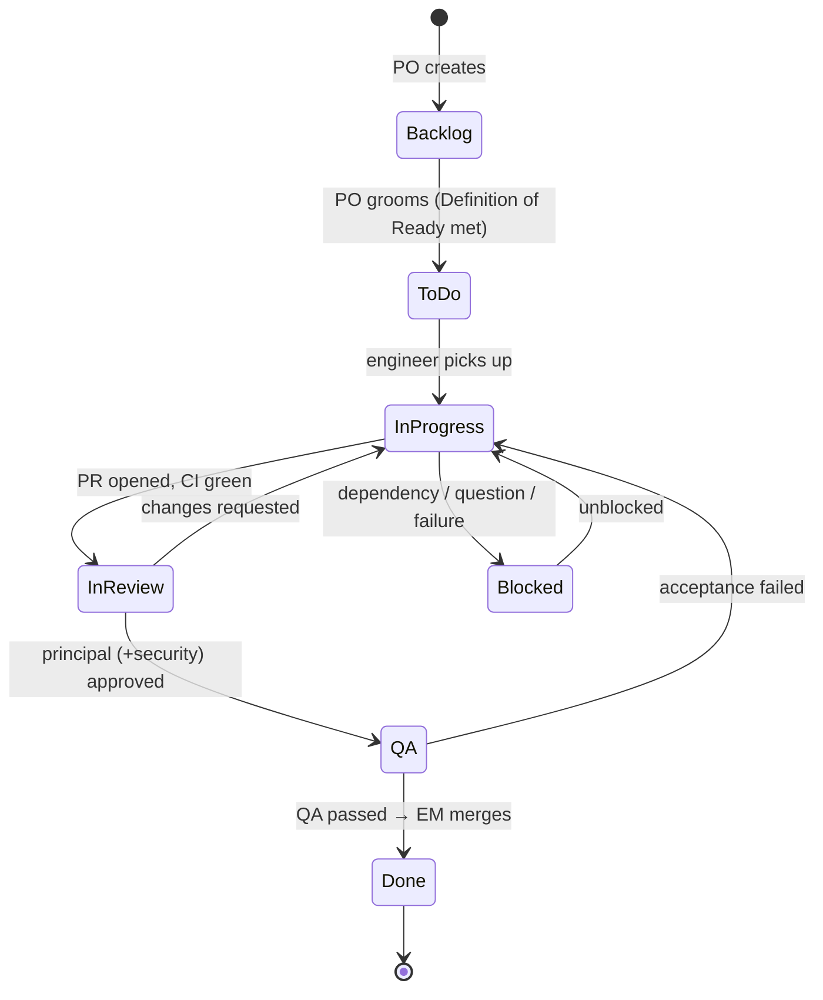

# Agent workflow: Jira + GitHub

How the Claude agent team plans, tracks, builds, reviews and ships work. All agents follow this. `CLAUDE.md` has the short version.

---

## 1. One-time setup (human)

### 1.1 GitHub (public repo)
1. Create a public repo `sms-manager` and push this folder.
2. Branch protection on `main`:
   - require a PR
   - require status checks (`ci`)
   - require linear history
   - no force-push
3. Install the **GitHub for Jira** app and connect it to the Jira site. Branches, commits and PRs containing `SMM-<n>` then appear on the issues automatically.
4. Labels (create once, or let `devops-engineer` do it with `gh label create`, after confirmation):
   - `review:approved`, `review:changes-requested`, `security-review`
   - `area:backend`, `area:frontend`, `area:infra`, `area:sre`, `area:ai`, `area:docs`
5. `gh auth login` on the machine that runs Claude Code.

> **Note:** all agents use one GitHub identity, and GitHub doesn't allow approving your own PR. Reviews are therefore posted as **review comments** with a verdict line, plus a `review:*` label. Branch protection should require CI, not a formal approval. Add a human approval requirement if you want a human gate on merges.

### 1.2 Jira (public board)
1. Create a **Scrum** software project with key **`SMM`**.
   - Do not use `SMS`: that prefix is used by our error codes (`SMS-4102`).
2. Workflow statuses, in order:
   `Backlog → To Do → In Progress → In Review → QA → Done`, plus **Blocked** (reachable from any status).
   - If you keep the default simple workflow (`To Do / In Progress / Done`), agents put the missing states in comments and labels instead (see §4.3).
3. Issue types: Epic, Story, Task, Bug, Sub-task.
4. Components, matching the repo: `gateway-api`, `dispatcher`, `dlr-service`, `callback-dispatcher`, `scheduler`, `outbox-relay`, `otp-service`, `content-guard`, `admin-api`, `admin-panel`, `sdk`, `providers`, `infra`, `observability`, `docs`.
5. Make the board public: *Project settings → Permissions → Browse projects → "Anyone on the web"*. Your Jira plan must allow anonymous access.
6. Connect the Atlassian MCP server (already in `.mcp.json`). Run `claude`, then `/mcp`, choose **atlassian** and authenticate with OAuth.

### 1.3 First run
```bash
claude --agent engineering-manager
> /kickoff 0        # PO turns ARCHITECTURE.md Phase 0 into Jira epics/stories
> /sprint 0         # team executes Phase 0 tickets end to end
```

---

## 2. Roles and who touches Jira

| Agent | Creates issues | Transitions | Comments | GitHub |
|---|---|---|---|---|
| engineering-manager | — (asks PO) | any, for orchestration | sprint/merge summaries | merge PRs |
| product-owner | **Epics, stories, bugs, sub-tasks** | Backlog→To Do, any→Blocked/Done corrections | grooming, acceptance, reports | read-only |
| principal-engineer | Tech-debt tasks, ADR tasks | In Review→In Progress (changes) / →QA (approve) | review verdicts | PR review comments, labels |
| backend / frontend / devops / sre / ai engineers | Sub-tasks, bugs found | To Do→In Progress→In Review, →Blocked | plan, progress, PR link, blockers | branches, commits, PRs |
| qa-engineer | Bugs | QA→Done (pass) / QA→In Progress (fail) | test evidence | test PRs |
| security-engineer | Security bugs (no exploit details in public) | In Review→In Progress if blocking | security verdicts | PR review comments |

Every agent comment starts with its signature line so readers on the public board can tell who said what:
```
🤖 **[backend-engineer]** · <short title>
```

---

## 3. Atlassian MCP usage rules

Tool names, with server name `atlassian`:
- `mcp__atlassian__getAccessibleAtlassianResources`
- `mcp__atlassian__getVisibleJiraProjects`
- `mcp__atlassian__getJiraProjectIssueTypesMetadata`
- `mcp__atlassian__createJiraIssue`, `mcp__atlassian__editJiraIssue`, `mcp__atlassian__getJiraIssue`
- `mcp__atlassian__searchJiraIssuesUsingJql`
- `mcp__atlassian__getTransitionsForJiraIssue`, `mcp__atlassian__transitionJiraIssue`
- `mcp__atlassian__addCommentToJiraIssue`
- `mcp__atlassian__createIssueLink`, `mcp__atlassian__getIssueLinkTypes`
- `mcp__atlassian__lookupJiraAccountId`
- `mcp__atlassian__addWorklogToJiraIssue`

Exact names can differ slightly between MCP server versions. Check with `/mcp` and adapt.

**Rules:**
1. **cloudId:** call `getAccessibleAtlassianResources` once per session and reuse the id. If `JIRA_CLOUD_ID` in `CLAUDE.md` is still a placeholder, tell the human its value so they can fill it in.
2. **Transitions:** never hard-code transition IDs. Call `getTransitionsForJiraIssue`, pick the transition whose *target status name* matches, then call `transitionJiraIssue`. If no matching transition exists, comment the intended status and add a label `status:<name>` (see §4.3).
3. **Idempotency:** before creating an issue, search with JQL for an existing one (same summary or `labels = "arch:§x.y"`). Don't create duplicates.
4. **Batching:** create epics first, then stories with `parent` = epic key, then dependency links (`Blocks`).
5. **Public content:** no secrets, internal hosts, real phone numbers or customer data in any field (see `CLAUDE.md`).
6. **Rate:** when creating a large backlog, pause briefly between batches and retry on 429 with backoff.

---

## 4. Issue lifecycle



### 4.1 Definition of Ready (PO ensures before To Do)
- Summary in imperative form, e.g. "Implement Kavenegar send adapter".
- Description has: **Context, Scope, Out of scope, Acceptance Criteria (Given/When/Then), Technical notes (ARCHITECTURE § refs), Dependencies**.
- Labels: `role:<agent>`, `phase:<n>`, `arch:§<section>`. Component set.
- Estimate in story points (1, 2, 3, 5, 8). An 8 must be split.
- Blocking issues linked.

### 4.2 Definition of Done
- Acceptance criteria met and verified by QA.
- CI green: lint, unit, integration, `buf breaking`, security scans.
- Metrics, traces and logs added for new paths. Runbook added if a new alert was added.
- Docs/README/ADR updated. Error catalog updated if new codes were added.
- Reviewed by principal (and security when required). PR squash-merged.
- Jira has a closing comment with the PR link and a summary.

### 4.3 Fallback for a simple 3-status workflow
| Desired | Status used | Plus label |
|---|---|---|
| In Review | In Progress | `status:in-review` |
| QA | In Progress | `status:qa` |
| Blocked | (unchanged) | `status:blocked` + comment |

Remove the label when leaving that state.

---

## 5. Comment templates

**Start** (engineer, on → In Progress):
```
🤖 **[backend-engineer]** · Started
**Plan**
1. ...
2. ...
**Branch:** `feat/SMM-42-kavenegar-adapter`
**Touches:** pkg/providers/kavenegar, pkg/smserr
**Risks/questions:** none | <list>
```

**Progress** (at least when a meaningful chunk is done, or before stopping):
```
🤖 **[backend-engineer]** · Progress
- Done: ...
- Next: ...
```

**Blocked:**
```
🤖 **[backend-engineer]** · Blocked
**Reason:** waiting on SMM-37 (proto for MessageService) / question for PO: ...
**Needed from:** product-owner | principal-engineer | human
```

**PR opened** (→ In Review):
```
🤖 **[backend-engineer]** · PR ready for review
**PR:** https://github.com/<owner>/sms-manager/pull/<n>
**Summary:** ...
**Tests:** unit ✔ integration ✔ (coverage 82% → 84%)
**AC checklist:** [x] AC1 [x] AC2 [x] AC3
```

**Review verdict** (principal / security):
```
🤖 **[principal-engineer]** · Review: APPROVED | CHANGES REQUESTED
**PR:** #<n>
**Must fix:** 1) ... 2) ...
**Nice to have:** ...
**Architecture alignment:** ✔ §5 adapter contract, ✔ §12 errors
```

**QA:**
```
🤖 **[qa-engineer]** · QA PASSED | QA FAILED
| AC | Result | Evidence |
|---|---|---|
| AC1 | ✔ | test/e2e/send_test.go::TestSendHappyPath |
```

**Done** (engineering-manager after merge):
```
🤖 **[engineering-manager]** · Done
Merged #<n> (squash <sha>) into main. Release notes will include it via release-please.
```

---

## 6. GitHub conventions
- **Branch:** `<type>/SMM-<n>-<slug>`. Types: `feat`, `fix`, `chore`, `docs`, `refactor`, `test`, `ci`, `perf`.
- **Commits:** Conventional Commits, scope = component path, key in subject: `fix(dispatcher): stop double-ack on retry (SMM-77)`.
- **PR title** = squash commit message. The body follows `.github/pull_request_template.md`: Jira link, summary, AC checklist, test evidence, observability notes, risk/rollback.
- **Review comments:** `gh pr review <n> --comment --body-file <file>` + `gh pr edit <n> --add-label review:approved` (or `review:changes-requested`, removing the other).
- **Merge:** `gh pr merge <n> --squash --delete-branch` only when:
  - CI is green
  - the `review:approved` label is present
  - the QA comment shows PASSED
  - the PR has no security-review label pending
- Never merge your own PR as the implementing agent. Only `engineering-manager` merges.

---

## 7. Orchestration loop (`engineering-manager`)

```text
loop:
  1. JQL: project = SMM AND sprint in openSprints() AND status in ("To Do","In Progress","In Review","QA","Blocked")
         ORDER BY priority DESC, rank
  2. For each issue in QA with QA PASSED + approved PR + green CI → merge, transition Done, comment.
  3. For each issue In Review without a verdict → spawn principal-engineer (and security-engineer if needed).
  4. For each issue In Review with APPROVED → spawn qa-engineer → QA.
  5. For each issue To Do whose blockers are Done (max N in parallel, default 3) → spawn the agent from label role:*
     (implementers run with isolation: worktree, one issue per agent).
  6. For Blocked issues → route the question to product-owner / principal-engineer, or ask the human.
  7. Stop when the sprint is empty or a human gate is hit. Then ask product-owner for a sprint report comment.
```

**Parallelism rules:**
- Never run two agents on issues that touch the same files/package. Use the `Touches:` line and the component to decide.
- Proto/contract issues and DB migration issues run **serially**.
- If an agent fails twice on the same issue: transition to Blocked, comment the failure summary, and escalate to the human.

---

## 8. Escalation to the human
Pause and ask when:
- A safety-rule action is needed (see `CLAUDE.md`).
- A requirement is ambiguous and PO can't resolve it from `ARCHITECTURE.md`.
- A decision would change the architecture/tech stack (ADR needs human sign-off).
- External accounts or credentials are needed (provider sandbox keys, GPU, cloud).
