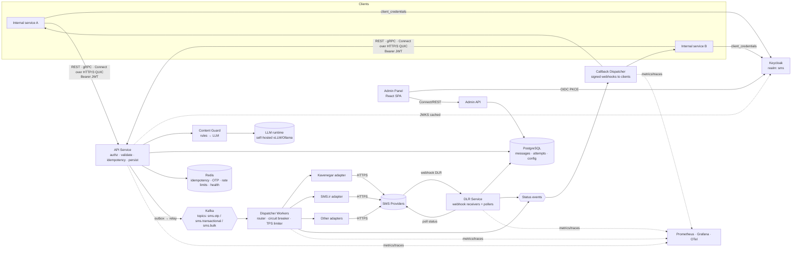
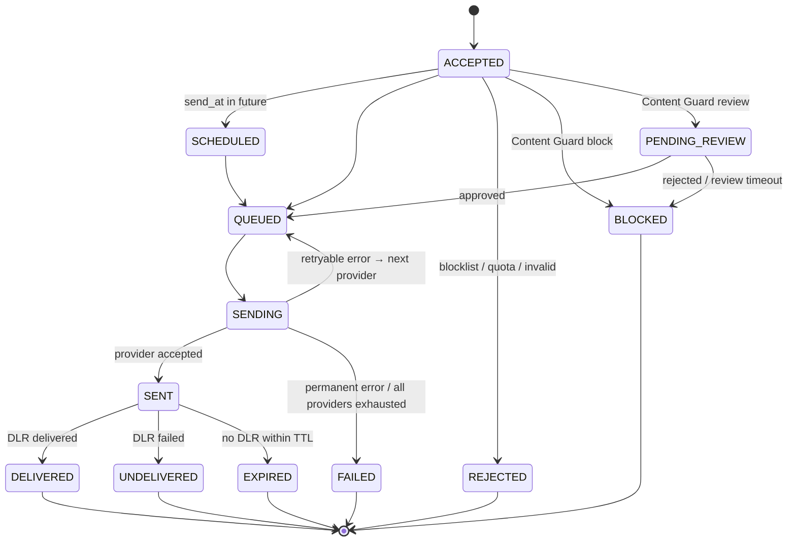
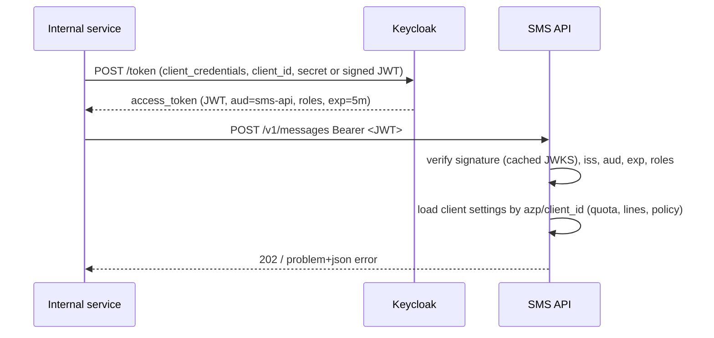
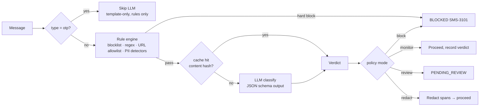
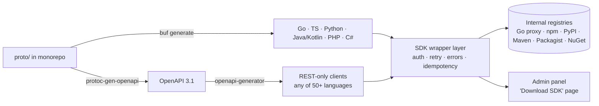

# SMS Manager — Architecture & Features (Draft v0.1)

_Date: 2026-10-20 · Status: draft v0.2 for review_

**Changelog v0.3:**
- Tech stack locked: Kafka, Go, PostgreSQL (§14)
- REST + gRPC + QUIC/HTTP3 client interfaces (§15)
- Dynamic SDK generator (§16)
- Full admin panel (§17)
- Monorepo layout and SRE engineering standards (§18)

**Changelog v0.2:**
- Keycloak authN/authZ (§11)
- Uniform error model with provider mapping (§12)
- LLM Content Guard: moderation, blocking and suggestions (§13)

## 1. Goals
- A **single API** that internal services call to send SMS and OTP. No service talks to a provider directly.
- **Reliable delivery**: routing, failover, retries, and circuit breaking across multiple Iranian providers.
- **Full tracking**: every message has one normalized status lifecycle, from accepted to delivered or failed.
- **Operable**: metrics, alerts, and dashboards fit our Prometheus/Grafana stack and GitOps deployment.
- **Consistent contract**: one auth model (Keycloak) and one error vocabulary, whichever provider handled the message.
- **Safe content**: messages can be checked, blocked, or improved by rules plus an LLM before they leave.

Non-goals for v1: marketing campaigns UI, SMPP server, international routing.

## 2. Feature list

### MVP (Phase 1)
| Area | Feature |
|---|---|
| API | `POST /v1/messages` (single and batch), `GET /v1/messages/{id}`, `Idempotency-Key` header, metadata/tags, priority (`otp` / `transactional` / `bulk`), scheduled send |
| OTP | `POST /v1/otp/send` and `POST /v1/otp/verify`: code generation, hashed storage in Redis with TTL, max attempts, resend cooldown. Uses the provider's template/verify endpoint when available |
| Providers | Adapter plugin per provider: **Kavenegar, SMS.ir** first, then Melipayamak, Ghasedak, Magfa, FarazSms. A capability matrix drives routing |
| Routing | Rule-based: by message type, destination operator prefix (MCI / Irancell / Rightel), client, and priority. Strategies: **priority-failover**, **weighted**, **least-cost** |
| Resilience | Per-provider circuit breaker, per-provider TPS limiter, retry with backoff, failover to the next provider on retryable errors |
| DLR | Webhook receivers **and** polling workers. Provider codes are mapped to one normalized status enum |
| Callbacks | Optional status webhook to the calling service, HMAC-signed, with retries |
| Auth | **Keycloak** OIDC: client-credentials for services, JWT validated via JWKS, role/scope-based permissions, per-client quota and rate limits, sender line assignment (§11) |
| Errors | **Uniform error catalog** (`SMS-xxxx` codes, RFC 9457 `problem+json`). Every provider error code is mapped to it, with the raw code kept for debugging (§12) |
| Content Guard | Deterministic rules (blocklist, regex, URL allowlist, card-number/PII detection). **LLM check in `monitor` mode**, and `POST /v1/content/suggest` for message improvement (§13) |
| Protection | Per-recipient rate limit (OTP abuse / SMS pumping), blocklist, Iranian MSISDN normalization (`+98`, `0098`, `09…`) |
| Encoding | Segment counter (Persian UCS-2: 70/67 chars; GSM-7: 160/153) used for cost estimation |
| Observability | Prometheus metrics, OpenTelemetry traces, structured JSON logs (phone masked, OTP never logged), Grafana dashboards, alert rules |

### Phase 2
- LLM Content Guard **`block` / `review` modes**, enabled per client after false-positive evaluation, plus a human review queue.
- Provider **balance/credit monitoring**, with an alert when credit runs low.
- **Health-based routing**: delivery rate and latency from recent window feed the routing weights.
- **DLR-timeout resend** for OTP only: if no DLR arrives within N seconds, re-send via another provider (opt-in policy).
- Inbound SMS (MO) receiving and forwarding to subscribers.
- Admin UI: providers, routes, clients, message search.
- Cost reports per client/provider/month.
- Audit log of config changes.

### Phase 3
- Config-as-code (routes and providers in Git, synced by ArgoCD).
- ChatOps commands (e.g. "disable provider X", "show delivery rate").
- SMPP connector (could wrap Jasmin) if we get direct operator binds.

## 3. High-level architecture



### Components
| Component | Responsibility | Scaling |
|---|---|---|
| **Keycloak** | Identity provider: service-account clients, roles, token issuing. Admin UI login (OIDC + PKCE) | Existing/HA Keycloak cluster |
| **API Service** | JWT validation and authz, validation, MSISDN normalization, idempotency check, rate limits, Content Guard call, persists message as `ACCEPTED`, writes outbox row in the same DB transaction. Returns uniform errors | Stateless, HPA on CPU/RPS |
| **Content Guard** | Rule engine plus pluggable LLM client. Gives verdicts (allow / flag / block / review) and suggestions. Caches verdicts by content hash | Stateless; LLM runtime scaled separately (GPU node) |
| **Outbox Relay** | Publishes outbox rows to Kafka (avoids DB/Kafka inconsistency). Option: Debezium CDC instead of an in-app relay | 1–2 replicas with leader lock |
| **Dispatcher Workers** | Consume per topic (lane), resolve route, pick provider, call adapter, record `attempt`, handle failover via retry topics | KEDA Kafka scaler on consumer lag; separate consumer group per lane so bulk never delays OTP |
| **Admin API** | Backend for the admin panel: CRUD on providers, routes, clients, policies, review queue, reports, audit log | Stateless |
| **SDK Generator** | Builds client SDKs from the proto/OpenAPI contract on demand or on release (§16) | Job-based |
| **Provider Adapters** | Library inside dispatcher/DLR (not separate services). Implements the common interface | — |
| **DLR Service** | `POST /dlr/{provider}` receivers, plus polling jobs for providers without webhooks. Maps codes to normalized status | Stateless receivers; pollers sharded by provider |
| **Callback Dispatcher** | Delivers status events to client webhooks with retry/backoff and dead-letter | Queue-driven |
| **Scheduler** | Releases scheduled messages, runs balance checks, expires stale `SENT` messages to `EXPIRED` | Single leader |

### Technology choices
See **§14 Tech stack** for the full, decided stack.

## 4. Message lifecycle



One **message** can have multiple **attempts**, one per provider try. The message status always reflects the latest meaningful attempt.

## 5. Provider adapter contract

```go
type Provider interface {
    Name() string
    Capabilities() Capabilities // Template, Bulk, LocalID, WebhookDLR, PollDLR, Unicode, MaxBatch

    Send(ctx context.Context, req SendRequest) (SendResult, error)
    SendTemplate(ctx context.Context, req TemplateRequest) (SendResult, error) // OTP / verify lookup
    QueryStatus(ctx context.Context, providerIDs []string) ([]StatusResult, error)
    ParseWebhook(r *http.Request) ([]StatusResult, error)
    Balance(ctx context.Context) (Balance, error)
}
```

Every adapter returns a `*sms.Error` built from the **provider error mapping** (§12), never a raw provider error. The `class` field drives failover:
| Class | Example | Action |
|---|---|---|
| `Retryable` | timeout before request sent, 5xx, 429, connection refused | Retry or fail over to the next provider |
| `Permanent` | invalid number, blocked recipient, bad template | Fail, no failover |
| `ProviderConfig` | auth error, no credit, line disabled | Open the circuit for that provider, fail over, **alert** |
| `Ambiguous` | timeout *after* request sent | OTP: fail over (a duplicate OTP is acceptable). Others: query status first and don't resend blindly |

## 6. Routing

Rules are evaluated in priority order. The first match wins and returns a strategy plus a provider list:

```yaml
routes:
  - name: otp-mci
    match: { type: otp, operator: MCI }
    strategy: priority_failover
    providers: [kavenegar, smsir, melipayamak]
  - name: otp-default
    match: { type: otp }
    strategy: priority_failover
    providers: [smsir, kavenegar]
  - name: bulk
    match: { type: bulk }
    strategy: least_cost
    providers: [melipayamak, ghasedak]
  - name: default
    strategy: weighted
    providers: [{ name: kavenegar, weight: 60 }, { name: smsir, weight: 40 }]
```

- Operator detection uses a configurable prefix table (MCI 091x/099x, Irancell 093x/090x/0941, Rightel 092x). This needs ported-number caveats.
- Providers whose circuit is open, or that lack a required capability (e.g. template), are skipped.
- Phase 2 adds a health score per provider/operator from delivery rate and latency over the last 15 minutes.

## 7. Data model (core tables)
- `clients` (id, **keycloak_client_id**, name, allowed_types, allowed_sender_lines, rate_limits, quota, content_policy_id, callback_url, callback_secret_ref). Identity lives in Keycloak; this table holds only SMS-specific settings
- `content_policies` (id, mode per message type, rule set ref, llm_enabled, fail_mode, categories config)
- `content_reviews` (message_id / content_hash, verdict, categories, confidence, reason, model, latency_ms, reviewer, decided_at)
- `error_mappings`: lives in code as versioned YAML per provider, with unit tests, not editable at runtime
- `providers` (id, name, type, enabled, config_ref → secret, cost_per_segment, tps_limit)
- `sender_lines` (provider_id, number, purpose, client_id nullable)
- `routes` (priority, match JSON, strategy, providers JSON)
- `messages` (id ULID, client_id, idempotency_key, to, body/encrypted or template_id+params, type, priority, segments, status, send_at, created_at, final_at, metadata) — partitioned by month
- `attempts` (id, message_id, provider, provider_msg_id, status, error_class, error_code, latency_ms, cost, created_at)
- `dlr_events` (raw payload, provider, received_at) — short retention, for debugging
- `outbox` (id, topic, payload, published_at)

Retention: message bodies kept 30–90 days (configurable), with metadata and status kept longer. OTP codes are **never** stored in Postgres.

## 8. API sketch

All endpoints require `Authorization: Bearer <Keycloak JWT>`.

```http
POST /v1/messages
Authorization: Bearer eyJhbGciOi...
Idempotency-Key: 6f1c...
{
  "to": "09121234567",
  "type": "transactional",
  "text": "سفارش شما ثبت شد",
  "metadata": { "order_id": "123" },
  "callback": true
}
→ 202 { "id": "01JB...", "status": "ACCEPTED", "segments": 1 }

POST /v1/otp/send   { "to": "09121234567", "purpose": "login" }
→ 202 { "otp_id": "01JB...", "expires_in": 120 }

POST /v1/otp/verify { "otp_id": "01JB...", "code": "48213" }
→ 200 { "valid": true }
```

## 9. Observability
**Metrics** (Prometheus):
- `sms_messages_total{client,type,status}`
- `sms_provider_requests_total{provider,result,error_class}`
- `sms_provider_latency_seconds` (histogram)
- `sms_dlr_delivery_ratio{provider,operator}`
- `sms_time_to_delivery_seconds{provider,type}`
- `sms_queue_lag{lane}`
- `sms_circuit_state{provider}`
- `sms_provider_balance{provider}`
- `sms_errors_total{code,provider,class}`: unified error codes; alert on spikes of `SMS-5xxx`
- `sms_unmapped_provider_errors_total{provider,raw_code}`: should be 0; alert if > 0, since it means the mapping needs updating
- `sms_content_verdicts_total{verdict,category,source=rule|llm}`
- `sms_content_llm_latency_seconds`
- `sms_content_llm_failures_total`
- `sms_auth_failures_total{reason}`

**SLO candidates:**
- OTP: 99% accepted by a provider within 2 s, and 95% delivered within 30 s.
- API availability: 99.9%.

**Alerts:**
- A provider's delivery rate drops below X% vs baseline.
- A circuit is open.
- Credit is low.
- Queue lag is above threshold.
- DLR backlog keeps growing (pollers stuck).

## 10. Security
- Authentication and authorization via Keycloak (§11). No static API keys. Network policies also restrict callers to internal namespaces.
- LLM prompts treat message text as **untrusted input** (prompt-injection safe design, §13.6).
- Provider credentials come only from a secret store, injected at runtime.
- Logs mask phone numbers (`0912***4567`) and never contain OTP codes or full bodies of `otp` type messages.
- Provider webhooks are authenticated with a secret path token and/or an IP allowlist.
- Static egress IP is used where providers require IP whitelisting.

## 11. Authentication & authorization (Keycloak)

### 11.1 Model
- **Realm** `sms` (or a dedicated client set in the existing corporate realm).
- **Each internal service = one confidential Keycloak client** with *Service Accounts Enabled*. It gets tokens via the OAuth2 **client-credentials** grant.
- **Admin UI / ops users** log in via OIDC Authorization Code + PKCE. Users come from LDAP/AD federation if available.
- **SMS Manager API** is a resource server. It is registered as a bearer-only client `sms-api` and is the token **audience**.



### 11.2 Roles (client roles on `sms-api`)
| Role | Grants |
|---|---|
| `sms.send` | `POST /v1/messages` with types `transactional` |
| `sms.send.bulk` | bulk / batch sending |
| `sms.otp` | `/v1/otp/send`, `/v1/otp/verify` |
| `sms.read` | read own messages and status |
| `sms.read.all` | read all clients' messages (support / ops) |
| `content.suggest` | `/v1/content/suggest` |
| `content.review` | approve or reject `PENDING_REVIEW` messages |
| `sms.admin` | manage providers, routes, policies, clients |

### 11.3 Implementation notes
- JWT validation runs locally with **cached JWKS** (refreshed on `kid` miss and every N minutes), so there is no per-request call to Keycloak. Introspection is used only for the admin UI if revocation is required.
- Short-lived access tokens (5 min). Services cache and refresh tokens; a Go helper SDK will be provided.
- Prefer **client authentication with signed JWT (private_key_jwt)** or mTLS-bound tokens over shared secrets. Client secrets are stored in the caller's secret store, never in repos.
- Tenant mapping: `azp` (authorized party) → `clients.keycloak_client_id` → SMS-specific limits and policy.
- Keycloak clients are provisioned as code (Terraform `keycloak` provider or `keycloak-config-cli`) through GitOps.
- Callback webhooks *to* clients stay HMAC-signed, because Keycloak doesn't apply to outbound calls.
- Failure mode: if JWKS can't be refreshed, keep using cached keys until they expire, then fail closed with `SMS-1003`.

## 12. Uniform error model

### 12.1 Response format (RFC 9457 `application/problem+json`)
```json
{
  "type": "https://sms.internal/errors/SMS-4102",
  "title": "Insufficient provider credit",
  "status": 502,
  "code": "SMS-4102",
  "class": "PROVIDER_CONFIG",
  "retryable": true,
  "message_id": "01JB...",
  "detail": "All eligible providers failed; last: kavenegar",
  "provider": { "name": "kavenegar", "raw_code": "418", "raw_message": "اعتبار حساب شما کافی نیست" },
  "trace_id": "4bf92f3577b34da6a3ce929d0e0e4736"
}
```
- `code` is stable and documented. Clients should branch on `code`/`class`, never on text.
- `provider.raw_*` appears only for roles with `sms.read.all` and in logs. Normal clients see the unified fields only.
- The same code set is used in sync API responses, in `attempts.error_code`, in status callbacks, and in metrics.

### 12.2 Error catalog
| Range | Domain | Examples |
|---|---|---|
| `SMS-1xxx` | Auth | `1001` missing/invalid token · `1002` insufficient role · `1003` auth service unavailable |
| `SMS-2xxx` | Request validation | `2001` invalid recipient · `2002` empty text · `2003` text too long · `2004` invalid template/params · `2005` invalid send_at · `2006` duplicate idempotency key with different payload |
| `SMS-3xxx` | Policy / limits | `3001` client rate limit · `3002` recipient rate limit · `3003` quota exceeded · `3004` recipient blocklisted · `3005` sender line not allowed · `3101` content blocked · `3102` content pending review · `3103` review rejected |
| `SMS-4xxx` | Provider (mapped) | `4001` provider auth failed · `4002` provider IP not whitelisted · `4101` invalid sender line · `4102` insufficient credit · `4201` recipient invalid at provider · `4202` recipient blocked/opted-out at operator · `4301` template not found · `4302` template param mismatch · `4401` provider rate limited · `4501` provider internal error · `4502` provider timeout · `4999` unmapped provider error |
| `SMS-5xxx` | Delivery (DLR) | `5001` undelivered · `5002` expired (no DLR) · `5003` rejected by operator · `5004` handset unreachable/off · `5005` blocked by operator (blacklist/DND) |
| `SMS-9xxx` | Internal | `9001` internal error · `9002` dependency unavailable (DB/queue) · `9003` all providers unavailable |

Each code has a fixed **class** (`RETRYABLE`, `PERMANENT`, `PROVIDER_CONFIG`, `AMBIGUOUS`, `CLIENT`), which drives failover (§5).

### 12.3 Provider mapping
Mappings live in versioned YAML per provider, embedded in the binary, with **table-driven unit tests** and contract tests against provider sandboxes.

```yaml
# mappings/kavenegar.yaml  (codes to be verified against current Kavenegar docs)
provider: kavenegar
send_errors:
  "403": { code: SMS-4001, class: PROVIDER_CONFIG }   # invalid API key
  "407": { code: SMS-4002, class: PROVIDER_CONFIG }   # IP not allowed
  "412": { code: SMS-4101, class: PROVIDER_CONFIG }   # invalid sender
  "418": { code: SMS-4102, class: PROVIDER_CONFIG }   # insufficient credit
  "411": { code: SMS-4201, class: PERMANENT }         # invalid receptor
  "424": { code: SMS-4301, class: PERMANENT }         # template not found
  "431": { code: SMS-4302, class: PERMANENT }         # token/param invalid
  "409": { code: SMS-4501, class: RETRYABLE }         # server unable to respond
  "default_5xx": { code: SMS-4501, class: RETRYABLE }
  "default":     { code: SMS-4999, class: AMBIGUOUS }
dlr_status:
  "10": { status: DELIVERED }
  "11": { status: UNDELIVERED, code: SMS-5001 }
  "14": { status: UNDELIVERED, code: SMS-5005 }
  "6":  { status: UNDELIVERED, code: SMS-5003 }
  "1":  { status: SENT }        # in queue at provider
  "2":  { status: SENT }        # scheduled
  "4":  { status: SENT }        # sent to operator
```
```yaml
# mappings/smsir.yaml  (fill from SMS.ir v1 API status table)
provider: smsir
send_errors:
  # "<status>": { code: SMS-xxxx, class: ... }
  "default": { code: SMS-4999, class: AMBIGUOUS }
dlr_status: {}
```

**Rules:**
- An unknown provider code maps to `SMS-4999 / AMBIGUOUS`, increments `sms_unmapped_provider_errors_total`, and logs the raw payload. Mapping gaps show up quickly and never crash anything.
- HTTP-level failures (DNS, TLS, connect refused, timeouts) are mapped in the shared HTTP client layer, not per adapter.
- An `error-catalog.md` is generated from code for client teams.

## 13. Content Guard (rules + LLM)

### 13.1 Purpose
1. **Check:** classify message content (phishing, fraud/scam, abusive, illegal/regulatory, sensitive data leakage such as card numbers/passwords, spam).
2. **Block / censor:** block, hold for review, or redact parts of a message according to policy.
3. **Suggest:** propose better wording (clarity, tone, Persian grammar, shorter to fit fewer segments, compliance-friendly).

### 13.2 Pipeline


- **Rules first**: cheap, deterministic, and auditable, so they always win over the LLM. Examples: Iranian card number (16 digits + Luhn), IBAN `IR..`, password-like patterns, non-allowlisted short links, keyword blocklist.
- **LLM second**, only for `transactional` and `bulk` (OTP is template-based and latency-critical).
- **Bulk**: the same text is classified **once** per content hash (template with placeholders), not per recipient.

### 13.3 Policy per client and message type
```yaml
content_policy: default
modes:
  otp: rules_only
  transactional: monitor      # off | monitor | review | block | redact
  bulk: review
llm:
  enabled: true
  timeout_ms: 1500            # sync path budget
  fail_mode: open             # open = proceed if LLM down; closed = hold for review
  block_threshold: 0.85
  review_threshold: 0.6
categories: [phishing, fraud, abusive, illegal, sensitive_data, spam, political]
```
New clients start in **`monitor`** mode. `block` mode is enabled only after measuring false positives on real traffic.

### 13.4 LLM integration
- **Interface** `ContentModel { Classify(ctx, text, lang) (Verdict, error); Suggest(ctx, text, goal) ([]Suggestion, error) }`. Backends: vLLM/Ollama (OpenAI-compatible API) by default. External API backends are possible behind the same interface.
- **Self-hosted model recommended**, since messages contain customer data. Run it on a GPU node pool in-cluster with no data leaving the network.
- **PII masking before the LLM**: phone numbers, names in placeholders, and amounts are replaced with tokens (`<PHONE>`, `<AMOUNT>`).
- Output constrained to a **JSON schema** (vLLM guided decoding / Ollama `format`):
```json
{ "decision": "allow|flag|block", "categories": ["phishing"], "confidence": 0.91,
  "reason": "Asks user to enter card info via unknown link", "spans": [[34, 58]] }
```
- Model version and prompt version are stored with each verdict for audit and re-evaluation.

### 13.5 Suggestions API
```http
POST /v1/content/suggest          (role: content.suggest)
{ "text": "...", "type": "transactional", "goals": ["shorter", "formal", "clear_cta"] }
→ 200 {
  "original": { "segments": 3, "verdict": "allow" },
  "suggestions": [
    { "text": "...", "segments": 1, "changes": ["shortened", "fixed grammar"] },
    { "text": "...", "segments": 2, "changes": ["more formal"] }
  ]
}
```
- **Advisory only.** The system never rewrites a message silently. Suggestions are also re-checked by Content Guard.
- Also exposed in the Admin UI for template authors, and as `POST /v1/content/check` for dry-run verdicts.

### 13.6 Safety of the LLM component itself
- Message text is **untrusted**: it's placed in a delimited user field, and the system prompt states it's data to classify, not instructions to follow.
- LLM output is validated against the schema. Invalid output counts as an LLM failure and `fail_mode` applies.
- The LLM can never *allow* something the rule engine blocked.
- An evaluation set (labeled Persian/English messages) runs in CI on prompt or model changes, tracking precision/recall per category.
- Review actions (approve/reject) are audit-logged with the Keycloak user identity.

## 14. Tech stack

| Layer | Choice | Notes |
|---|---|---|
| Language (services) | **Go** (latest stable) | Single Go module in the monorepo. `log/slog`, `net/http`, `context` everywhere |
| API contract | **Protobuf** (source of truth) + **Buf** | `buf lint` and `buf breaking` in CI. REST/OpenAPI generated from proto |
| RPC framework | **ConnectRPC (connect-go)** | One handler serves **gRPC, gRPC-Web, and Connect** over HTTP/1.1, HTTP/2 and **HTTP/3**. REST via **Vanguard** transcoding from `google.api.http` annotations |
| HTTP/3 / QUIC | **quic-go** (`http3.Server`) | Same handlers mounted on HTTP/2 (TCP) and HTTP/3 (UDP), with `Alt-Svc` advertising |
| Message broker | **Apache Kafka** via **Strimzi** operator (KRaft mode) | Protobuf event schemas in a schema registry (Apicurio or Confluent SR) |
| Kafka client | **franz-go** | Pure Go, fast, good transactions/idempotent-producer support |
| RDBMS | **PostgreSQL** (CloudNativePG operator) | Monthly partitions for `messages`/`attempts`. **pgx** driver, **sqlc** for type-safe queries, **goose** or **Atlas** migrations |
| Cache / state | **Redis** (or Valkey) | Idempotency keys, OTP, rate limits, provider health, JWKS cache |
| Identity | **Keycloak** | §11 |
| LLM runtime | **vLLM** (prod) / **Ollama** (dev), OpenAI-compatible API | §13 |
| Admin panel | **React + TypeScript + Vite**, TanStack Query/Router, shadcn/ui, Connect-ES client | RTL + Persian + Jalali dates (§17) |
| Observability | **OpenTelemetry** SDK → OTel Collector → **Prometheus/Mimir**, **Tempo**, **Loki**, **Pyroscope**, **Grafana** | §18.3 |
| Deploy | Kubernetes, **Helm**, **ArgoCD** (GitOps), **KEDA** | Images built with `ko` or distroless Dockerfiles |
| Secrets | Vault / External Secrets Operator | Never in repo |
| CI | **GitHub Actions**, images and packages on **GHCR / GitHub Packages** | Affected-only builds (§18.5) |

### 14.1 Kafka topic design
| Topic | Key | Purpose | Partitions (start) |
|---|---|---|---|
| `sms.send.otp` | message_id | OTP lane, highest priority | 12 |
| `sms.send.transactional` | message_id | Transactional lane | 12 |
| `sms.send.bulk` | batch_id | Bulk lane, throttled | 24 |
| `sms.retry.5s` / `sms.retry.30s` / `sms.retry.5m` | message_id | Delayed retry tiers: consumer pauses until `not_before` header | 6 |
| `sms.dlq` | message_id | Exhausted or poison messages, with alert and replay tool in admin panel | 3 |
| `sms.status.events` | message_id | All status transitions, consumed by callback dispatcher, analytics, admin live view | 12 |
| `sms.dlr.raw` | provider | Raw provider webhooks before normalization (replayable) | 6 |
| `sms.audit` | entity_id | Config/admin changes | 3 |

**Rules:**
- Kafka has no per-message priority, so **lanes = separate topics and separate consumer groups**.
- Scheduled messages wait in Postgres and are released by the Scheduler. Kafka is not used for long delays.
- Consumers are **idempotent**: `attempts` has a unique key on (message_id, attempt_no), and status updates are monotonic, so at-least-once delivery is safe.
- Producer settings: `acks=all`, idempotence on, `min.insync.replicas=2`, RF=3.
- Trace context is propagated in Kafka headers (W3C `traceparent`).

## 15. Client interfaces: REST, gRPC, QUIC

Proto is the single contract. All three transports are generated from it, so they can't drift apart.

```proto
service MessageService {
  rpc SendMessage(SendMessageRequest) returns (SendMessageResponse) {
    option (google.api.http) = { post: "/v1/messages" body: "*" };
  }
  rpc GetMessage(GetMessageRequest) returns (Message) {
    option (google.api.http) = { get: "/v1/messages/{id}" };
  }
  rpc WatchMessageStatus(WatchRequest) returns (stream StatusEvent); // server streaming
}
service OtpService { rpc Send(...) ...; rpc Verify(...) ...; }
service ContentService { rpc Check(...) ...; rpc Suggest(...) ...; }
```

| Transport | Endpoint | Best for |
|---|---|---|
| **REST/JSON** | `https://sms-api.internal/v1/...` (HTTP/1.1, HTTP/2, HTTP/3) | Any language, simple integrations, debugging with curl |
| **gRPC** | `sms-api.internal:443` (HTTP/2) | Go/Java/Kotlin backend services, streaming status |
| **Connect / HTTP/3 (QUIC)** | Same host, UDP 443, discovered via `Alt-Svc` | Lower latency on lossy links, no TCP head-of-line blocking, fast reconnect (0-RTT disabled for non-idempotent calls) |

**Notes and caveats:**
- Standard gRPC clients don't speak HTTP/3 yet, so **QUIC is offered via the Connect protocol and REST over HTTP/3**. The generated SDKs (§16) enable it automatically with fallback to HTTP/2.
- **Ingress must pass UDP/443**: use Envoy Gateway (HTTP/3 supported) or a dedicated UDP LoadBalancer Service. This must be validated with the network team (firewalls often drop UDP 443).
- Errors map to the §12 catalog in every transport: gRPC status + `ErrorInfo` detail carrying the `SMS-xxxx` code, and REST `problem+json`.
- gRPC **server reflection** and an **OpenAPI 3.1** spec plus a Swagger/Scalar UI are published for exploration (grpcurl, Postman).
- Status updates can come by **webhook callback** (push), by **`WatchMessageStatus` stream**, or by polling `GetMessage`.

## 16. Dynamic client SDK generator

**Goal:** any team can get a ready-to-use, typed client in their language, always in sync with the API.



**Two modes:**
1. **Release mode (CI):** on every tagged API release, generate, test, and publish SDKs for the officially supported languages (Go, TypeScript, Python, Java/Kotlin, PHP) to internal registries, with semver matching the API version.
2. **On-demand mode (dynamic):** the admin panel's *SDK* page lets a developer pick language, transport (REST/gRPC/Connect), API version and package name. The **SDK Generator** service runs the generator in a sandboxed K8s Job and returns a zip or publishes a pre-release package. Results are cached by (contract hash, options).

**Thin hand-written wrapper per supported language:**
- Keycloak client-credentials token fetch and cache/refresh.
- Automatic `Idempotency-Key` generation and safe retries (only for `RETRYABLE` codes).
- Typed errors from the `SMS-xxxx` catalog (e.g. `errors.Is(err, sms.ErrInsufficientCredit)`).
- OTel instrumentation (client spans, `traceparent` injection).
- HTTP/3-first with HTTP/2 fallback (where the language runtime supports it).

**Quality gates:**
- `buf breaking` blocks incompatible proto changes on the same major version.
- Generated SDKs run contract tests against a live API in CI (ephemeral environment).
- A changelog is generated per SDK release (§18.2).

## 17. Admin panel

**Stack:** React + TS SPA → Admin API (Go, Connect). Login via Keycloak OIDC + PKCE. Permissions come from Keycloak roles. Full **RTL/Persian** UI with **Jalali** calendar, and an English toggle.

| Module | Capabilities |
|---|---|
| **Dashboard** | Live throughput, delivery rate per provider/operator, queue lag, error top-N by `SMS-xxxx`, credit balances, SLO burn. Embedded Grafana panels plus native widgets |
| **Messages** | Search/filter (phone masked unless `sms.read.all`, client, status, date, error code, provider), detail view with **attempt timeline** (route chosen, provider responses, DLRs, callbacks, trace link to Tempo), resend action |
| **Providers** | Add/edit provider (credentials stored as secret refs), enable/disable, TPS limits, cost per segment, circuit state, health score, **"test send"**, balance history |
| **Sender lines** | Manage lines per provider, purpose (OTP/marketing), client assignment |
| **Routing** | Visual rule editor (priority list), strategies, **route simulator** ("which provider would 0912… OTP from client X use, and why?"), versioned with diff and rollback |
| **Clients** | Onboard service: creates the Keycloak client via Admin API, sets roles, quotas, rate limits, allowed types/lines, content policy, callback URL/secret, and shows integration snippet |
| **Content Guard** | Policy editor, rule/blocklist editor, **review queue** (approve/reject with reason), verdict explorer, LLM eval results, "check & suggest" playground |
| **Errors** | Error catalog browser, provider mapping viewer, **unmapped errors inbox** |
| **DLQ** | Inspect dead-lettered messages, replay or discard (with confirmation) |
| **OTP** | Success/verify rates, abuse detection (top numbers/IP ranges), per-purpose stats |
| **Blocklist / opt-out** | Manage numbers and prefixes, import CSV |
| **Reports** | Cost and volume per client/provider/operator/month, export CSV/XLSX |
| **SDKs & Docs** | Download/generate SDKs (§16), API reference (OpenAPI/Scalar), proto browser, changelog |
| **Audit log** | Every admin change (who, what, before/after diff) from `sms.audit` |
| **Settings** | Feature flags, retention, global limits |

**Rules:**
- Destructive actions (disable provider, purge, DLQ discard, bulk resend) need a confirmation dialog and are audit-logged.
- Config changes are **versioned**. Phase 3 can export them to Git for config-as-code.

## 18. Monorepo & SRE engineering standards

### 18.1 Repository layout
```
sms-manager/
├── api/proto/sms/v1/            # protobuf contracts (source of truth), buf.yaml, buf.gen.yaml
├── cmd/                         # one main per deployable
│   ├── gateway-api/             # public REST/gRPC/Connect + HTTP/3
│   ├── dispatcher/
│   ├── dlr-service/
│   ├── callback-dispatcher/
│   ├── scheduler/
│   ├── outbox-relay/
│   ├── otp-service/             # may start inside gateway-api
│   ├── content-guard/
│   ├── admin-api/
│   └── sdk-generator/
├── internal/                    # service-private code (per service subdirs)
├── pkg/                         # shared libraries
│   ├── observability/           # otel setup, slog, metrics helpers, middleware
│   ├── smserr/                  # unified error catalog + gRPC/REST mapping
│   ├── auth/                    # Keycloak JWT/JWKS, role checks
│   ├── kafkax/                  # franz-go wrappers, header propagation, retry topics
│   ├── db/                      # pgx pool, sqlc generated, migrations runner
│   ├── providers/               # adapter interface + kavenegar/, smsir/, ... + mappings/*.yaml
│   ├── routing/
│   ├── contentguard/
│   └── msisdn/                  # Iranian number normalization, operator prefixes
├── gen/                         # generated code (proto Go, sqlc), committed or generated in CI
├── migrations/                  # SQL migrations
├── web/admin/                   # React admin panel (pnpm)
├── sdks/                        # SDK wrappers + generator templates per language
├── deploy/
│   ├── helm/sms-manager/        # umbrella chart, one subchart per service
│   ├── argocd/                  # ApplicationSets per environment
│   ├── kafka/                   # Strimzi Kafka, KafkaTopic CRs
│   ├── keycloak/                # realm/client config as code
│   └── observability/           # dashboards (JSON/Grafonnet), alert rules, SLOs (Sloth/Pyrra)
├── test/
│   ├── e2e/                     # full flow against ephemeral env
│   ├── load/                    # k6 scenarios (OTP burst, bulk 1M)
│   └── providersim/             # fake provider server with fault injection (latency, 5xx, DLR loss)
├── docs/
│   ├── ARCHITECTURE.md
│   ├── adr/                     # Architecture Decision Records
│   ├── runbooks/                # one per alert
│   └── error-catalog.md         # generated
├── tools/                       # dev tooling, codegen scripts
├── Taskfile.yml                 # task dev | gen | lint | test | build
├── docker-compose.dev.yml       # local stack: kafka, postgres, redis, keycloak, ollama, providersim
├── go.mod
├── .golangci.yml
├── release-please-config.json
└── CHANGELOG.md                 # root; plus per-component changelogs
```

### 18.2 Changelog & versioning
- **Conventional Commits** enforced by commitlint in CI and a pre-commit hook. Scopes match components, e.g. `feat(dispatcher): ...`, `fix(providers/kavenegar): ...`.
- **release-please (monorepo mode)** opens release PRs per component and generates **per-component `CHANGELOG.md`** plus semver tags (`dispatcher/v1.4.0`, `sdk-go/v1.2.0`, `api/v1.3.0`).
- Every image is tagged with semver + git SHA. Images expose `/version` and a `build_info{version,commit}` metric.
- Deployments create **Grafana annotations**, so dashboards show when each release went out.
- ADRs are recorded for every significant decision (Kafka over RabbitMQ, Connect, etc.).

### 18.3 Observability built into every service
Every service gets these for free via `pkg/observability`:

| Signal | Standard |
|---|---|
| **Metrics** | OTel/Prometheus. **RED** for every endpoint/consumer (rate, errors by `SMS-xxxx`, duration histograms), **USE** for pools (DB, Kafka, HTTP clients). Common labels: `service`, `version`, `env`. Cardinality guard: no phone numbers or message IDs in labels |
| **Traces** | OTel with W3C context through HTTP, gRPC, **Kafka headers**, and provider HTTP calls. One trace = API request → dispatch → provider → DLR → callback. Tail sampling in the collector keeps 100% of errors and slow requests |
| **Logs** | `slog` JSON to stdout → Loki. Mandatory fields: `trace_id`, `span_id`, `service`, `message_id`, `client_id`, `error_code`. PII masking at the logger level |
| **Profiles** | Pyroscope continuous profiling (Go pprof) |
| **Health** | `/livez`, `/readyz` (checks DB/Kafka/Redis), graceful shutdown (drain HTTP, commit Kafka offsets) |
| **SLOs as code** | Sloth/Pyrra definitions → multi-window burn-rate alerts. Each alert links to a **runbook** in `docs/runbooks/` |
| **Dashboards as code** | In `deploy/observability/`, provisioned by GitOps |

### 18.4 Scalability & reliability
- All services are stateless, and state lives in Postgres/Redis/Kafka. **HPA** applies to APIs, and **KEDA** (Kafka lag) to consumers. Partition count caps consumer parallelism, so plan partitions for 3–5× peak.
- PodDisruptionBudgets, topology spread across nodes/zones, resource requests/limits, priority classes (OTP path highest).
- Backpressure: per-provider token buckets in Redis, Kafka consumer pause when providers are saturated, and API rate limits returning `SMS-3001` before overload.
- Connection pooling (pgx), PgBouncer if needed. Read replicas for admin/reporting queries.
- **Chaos and load testing:** `providersim` injects latency, errors, and lost DLRs. k6 runs in CI nightly against staging, with performance budgets.
- DR: Postgres PITR backups (CNPG + object storage), Kafka RF=3, and documented restore drills.

### 18.5 CI/CD pipeline (affected-only)
1. Detect changed components (paths + Go package graph).
2. `buf lint` + `buf breaking`, `golangci-lint`, `go test -race` with coverage, `sqlc vet`, admin panel lint and unit tests.
3. Security: `govulncheck`, Trivy (image + IaC), gitleaks (secrets), SBOM (Syft), **cosign** image signing.
4. Build images (`ko`/distroless, non-root, read-only rootfs).
5. Deploy to an ephemeral or staging env via ArgoCD and run e2e and SDK contract tests.
6. Release PR (release-please) → tag → promote to production via GitOps PR (manual approval).

### 18.6 Local developer experience
- `task dev` starts `docker-compose.dev.yml` (Kafka, Postgres, Redis, Keycloak with seeded realm, Ollama, providersim, Grafana LGTM), with hot-reload via `air`.
- `task gen` regenerates proto, sqlc, mocks and the error catalog doc.
- Optional: Tilt + kind for a K8s-like local loop.

## 19. Delivery plan
| Phase | Scope | Rough size |
|---|---|---|
| 0 | **Monorepo scaffold**: proto + buf, `pkg/observability`, `pkg/smserr`, CI pipeline, release-please, local dev stack, Helm/ArgoCD skeleton, Strimzi Kafka + CNPG in dev | 2 weeks |
| 1a | Gateway API (REST + gRPC + Connect, HTTP/3 behind a flag), Keycloak auth, outbox → Kafka, dispatcher, Kavenegar & SMS.ir adapters with error mappings, priority-failover, polling DLR, metrics/traces/logs | 4–5 weeks |
| 1b | OTP service, webhook DLR, callback dispatcher, rate limits, Content Guard rules + LLM monitor + suggest API, Go/TS/Python SDKs (release mode), dashboards, SLOs, runbooks | 4 weeks |
| 2a | **Admin panel v1**: dashboard, messages, providers, routing + simulator, clients (Keycloak), errors, DLQ, audit log | 4–6 weeks |
| 2b | Content Guard block/review/redact + review queue UI, health routing, balance monitor, DLR-timeout resend, reports, on-demand SDK generator, more adapters | 5–6 weeks |
| 3 | Config-as-code export, ChatOps, SMPP connector, HTTP/3 GA after network validation | later |

## 20. Open questions
1. ~~Language/stack~~ Decided: Go, Kafka, PostgreSQL (§14). ~~CI~~ Decided: GitHub Actions + GHCR (public repo).
2. Expected volume: peak msg/s and daily total, OTP vs bulk split.
3. Launch providers: which 2–4 do we have contracts with?
4. Kafka: is there an existing in-house cluster to reuse, or do we run a dedicated Strimzi cluster? Is a schema registry already in place?
5. Callers: internal services only, or will external partners use it too?
6. Is inbound SMS (MO) needed in v1?
7. Data residency / retention rules for message content (compliance)?
8. Keycloak: is there an existing HA cluster and realm to use, and is LDAP/AD federated?
9. LLM: is a GPU node available for self-hosting, or is an external LLM API acceptable after PII masking?
10. Content policy: who owns the category definitions and the review queue (security, compliance, product)?
11. HTTP/3: does the internal network/ingress allow UDP 443 between client services and the gateway?
12. Which SDK languages are needed in release mode (beyond Go/TS/Python)? Which package registry (Nexus, GitLab, Artifactory)?
