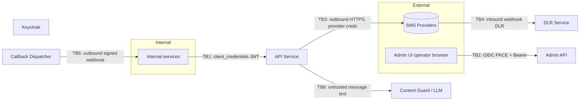

# SMS Manager — Threat Model (v1, Phase 0 baseline)

_Status: living document. Owner: `security-engineer`. Last updated: 2026-10-21 (SMM-17)._

This is a baseline, STRIDE-style pass over the architecture described in `docs/ARCHITECTURE.md`
§3 (high-level architecture), §10 (security), §11 (authN/authZ) and §13.6 (LLM
prompt-injection safety), done before Phase 1 contributors add real code touching auth,
OTP, webhooks or providers. It is **not** a replacement for protocol-level review of the
Keycloak/JWT flows — that happens once the gateway-api auth story lands in Phase 1 with
real code to review (see open items below).

Update this document — don't replace it — whenever a Phase 1+ story changes a trust
boundary or introduces a new one (new auth flow, new provider integration, new webhook
direction, etc.).

## 1. Public-repo baseline (read first)

This repo and Jira board are **public** (`CLAUDE.md` safety rules). Every control below is
layered on top of two non-negotiable baseline rules that apply to every contributor and
every agent:

- **No secrets ever committed or posted.** No API keys, tokens, passwords, kubeconfigs, or
  `.env` files in the repo, PRs, Jira, or logs.
- **No real phone numbers, customer data, or internal hostnames/IPs.** Examples, fixtures,
  and tests use the reserved test MSISDN range **`0912000xxxx`** only.

STRIDE category **Information Disclosure** therefore has a standing, repo-wide mitigation:
anything that would disclose a secret or PII simply must not exist in version control or on
the public board in the first place. §4 below records the one-time audit that checked this
for everything committed so far.

## 2. Trust boundaries

| # | Boundary | Crosses from → to | Why it's a boundary |
|---|---|---|---|
| **TB1** | Internal services ↔ API | Any internal caller → API Service | Caller identity and authorization level change (client-credentials JWT, `azp` → tenant). Compromise of a caller's credential lets an attacker send/read SMS as that tenant. |
| **TB2** | Admin UI ↔ Admin API | Operator's browser (least-trusted execution environment: browser extensions, phishing, XSS) → Admin API | Highest-privilege actions (provider config, routes, policy, review approvals) are reachable from here. |
| **TB3** | API/Dispatcher ↔ providers | Our network → third-party provider HTTPS endpoints | Provider credentials leave our trust boundary on every call; provider responses are untrusted input (error codes, DLR payloads). |
| **TB4** | Providers ↔ webhooks in (DLR) | Third-party provider → our public DLR receiver endpoint | Unauthenticated-by-default inbound traffic from the public internet claiming to be a provider. |
| **TB5** | Callback dispatcher ↔ client webhooks out | Our network → client-owned endpoints (often also public internet) | We are the "untrusted" caller from the client's point of view; also a potential SSRF vector if the callback URL is attacker-influenced. |
| **TB6** | API/Content Guard ↔ LLM | End-user-authored message text → LLM prompt context | Message content is attacker-influenced (or customer-influenced) input flowing into a component that produces decisions (block/allow) and free-text output. |

## 3. Risks (STRIDE) and where they are addressed

| Risk | STRIDE | Description | Current/planned control (ARCHITECTURE.md ref) | Addressed by |
|---|---|---|---|---|
| **Token theft / replay** | Spoofing, Elevation of Privilege | A stolen or replayed JWT lets an attacker call the API as another tenant (send SMS, read messages, exhaust quota). | Short-lived (5 min) access tokens; JWT validated locally against cached JWKS (`iss`, `aud`, `exp`, role); `azp` → tenant mapping; prefer `private_key_jwt`/mTLS over shared client secrets (§11.3). | Phase 1 gateway-api auth story. This threat model flags it; **deep JWT-flow review is explicitly out of scope here** and will be a dedicated security review on that PR. |
| **Provider credential leakage** | Information Disclosure | Provider API keys/secrets committed to the repo, logged, or echoed in error responses. | Credentials come only from a secret store, injected at runtime, never in code/config (§10); `provider.raw_*` error fields restricted to `sms.read.all` role and logs only (§12.1). | Phase 1 providers/secrets story (backend-engineer) + SMM-10 (gitleaks in CI) as an automated backstop. Reviewed on every provider-adapter PR by `security-engineer`. |
| **OTP abuse / SMS pumping** | Denial of Service, Repudiation | Attacker triggers mass OTP sends to premium-rate or arbitrary numbers to rack up cost or harass recipients; brute-forces OTP codes. | Per-recipient and per-client rate limits, resend cooldown, attempt limits, codes from `crypto/rand`, stored hashed with TTL (never in Postgres, §7), constant-time compare. | Phase 1 OTP-service story. Must ship rate limiting and attempt limits in the same PR as the OTP send/verify endpoints — `security-engineer` review gate blocks merge otherwise. |
| **Prompt injection via message content** | Tampering, Elevation of Privilege | Message text (attacker- or customer-controlled) tries to override the Content Guard's system prompt to force an "allow" verdict or exfiltrate instructions. | Message text treated as untrusted data in a delimited field, not instructions (§13.6); rule engine runs first and the LLM can never override a rule-engine block; LLM output constrained to a JSON schema; invalid output = LLM failure, `fail_mode` applies. | Phase 1 Content Guard story (`ai-engineer`). Eval set (Persian/English) in CI tracks regressions on prompt/model changes (§13.6). |
| **Public-repo secret/PII leakage** | Information Disclosure | Any agent or contributor accidentally commits a secret, real phone number, or internal hostname to the public repo/Jira. | `CLAUDE.md` baseline rule (test MSISDN range `0912000xxxx`, no secrets); one-time manual audit (§4 below); automated backstop via SMM-10 (gitleaks/Trivy/govulncheck in CI, not yet implemented). | This story (manual baseline) + SMM-10 (automated gate, separate story, not yet started). |
| **Inbound webhook (DLR) spoofing** | Spoofing, Tampering | Anyone can `POST` to the public DLR receiver claiming to be a provider, injecting fake delivery statuses. | Secret path token and/or IP allowlist per provider (§10); static egress IP where providers require whitelisting. | Phase 1 DLR-service story. Review gate: PR must show the per-provider auth mechanism before merge. |
| **Outbound webhook (callback) spoofing / SSRF** | Spoofing, Tampering | Forged "from us" webhooks accepted by a client without verification; or an attacker-influenced callback URL is used to reach internal/private network ranges (SSRF). | Outbound callbacks are HMAC-signed (§10, §11.3) — clients verify the signature. **Timestamp + replay-window and callback-URL SSRF allowlisting are not yet explicitly specified in ARCHITECTURE.md.** | Flagged as an open item (§5) for the Phase 1 callback-dispatcher story; `security-engineer` to confirm timestamped HMAC + private-range blocking lands with that PR. |
| **Admin UI compromise (XSS/CSRF/session)** | Spoofing, Elevation of Privilege | A compromised operator browser/session is used to reach high-privilege Admin API actions (provider config, policy changes, review approvals). | OIDC Authorization Code + PKCE login (§11.1); role-gated actions (`sms.admin`, `content.review`); audit log of review actions with Keycloak identity (§13.6). | Phase 1 admin-panel + admin-api stories (`frontend-engineer`/`backend-engineer`). Reviewed for CSRF/session handling on first Admin API PR. |
| **Unmapped/raw provider errors leaking vendor detail** | Information Disclosure, Repudiation | Raw provider error text/codes reaching normal clients could leak vendor-internal detail or be used to fingerprint provider selection. | Uniform error model: clients see unified `code`/`class` only; raw fields gated to `sms.read.all` (§12.1); unmapped codes still get a stable `SMS-4999` and increment a metric rather than passing raw text through (§12.3). | Already designed in; enforced via `pkg/smserr` review checklist on every PR touching error mapping. |
| **Repudiation of admin/content-review actions** | Repudiation | An operator approves/rejects a `PENDING_REVIEW` message and later denies it. | Review actions audit-logged with Keycloak user identity, model/prompt version stored with each verdict (§13.4, §13.6). | Phase 1 Content Guard + admin-api stories. |

## 4. One-time repo audit (SMM-17)

Performed 2026-10-21 against everything committed to `main` as of commit `b70ade7`
(SMM-2 scaffold — agent configs, Taskfile-less docs, `go.mod`, directory-placeholder
`README.md` files; no application code yet).

**Method:** full-repo `grep` over all tracked files for:
- secret-like key/value patterns (`api_key`, `secret`, `password`, `token`, `private_key`,
  PEM private-key headers);
- Iranian MSISDN-shaped strings (`09[0-9]{9}`) outside the reserved `0912000xxxx` test range;
- internal-looking hostnames/IPs (`*.internal`, `*.corp`, `*.intra`, bare IPv4 literals).

**Result:**
- **No secrets found.** No API keys, tokens, passwords, or private-key material in any
  tracked file.
- **No internal hostnames or IP literals found.**
- **One non-compliant example phone number found:** `docs/ARCHITECTURE.md` §8 ("API sketch")
  uses `09121234567` as an example MSISDN in two request examples (`POST /v1/messages`,
  `POST /v1/otp/send`). This is a plainly fictional example in a design document — not a
  real customer number — but it does not use the reserved test range `0912000xxxx` that
  `CLAUDE.md` specifies for exactly this purpose, so it does not meet the public-repo
  baseline as written. **Not fixed in this PR**: `docs/ARCHITECTURE.md` is out of this
  story's touch scope (owned by `principal-engineer`; avoids colliding with the parallel
  SMM-3/SMM-16 work on that file). Flagged here and in the closing Jira comment so
  `principal-engineer`/`product-owner` can make the one-line swap (`09121234567` →
  `09120001234` in both places) in a follow-up edit.

No other findings. This audit should be re-run (or superseded by SMM-10's automated
gitleaks/Trivy scan) once Phase 1 stories start landing real code and provider
configuration.

## 5. Open items for Phase 1

- Confirm outbound webhook HMAC signing includes a timestamp and a replay window (not
  just a static signature) — not yet explicit in ARCHITECTURE.md §10/§11.3.
- Confirm callback URLs supplied by clients are validated against an SSRF blocklist
  (private/loopback/link-local ranges) before the callback dispatcher calls them.
- Deep review of the Keycloak/JWT flow (JWKS rotation handling, `alg` allow-list,
  audience/issuer checks in code) once the gateway-api auth story has real code — tracked
  as a follow-up, not covered by this baseline pass.
- Swap `docs/ARCHITECTURE.md` §8 example MSISDN `09121234567` → `09120001234` (test range).
- Re-run or replace this manual audit with SMM-10's automated CI scanning once that story
  lands.

## 6. References

- `docs/ARCHITECTURE.md` §3, §10, §11, §13.6
- `CLAUDE.md` — Safety rules (public-repo baseline)
- `SECURITY.md` — vulnerability reporting process
